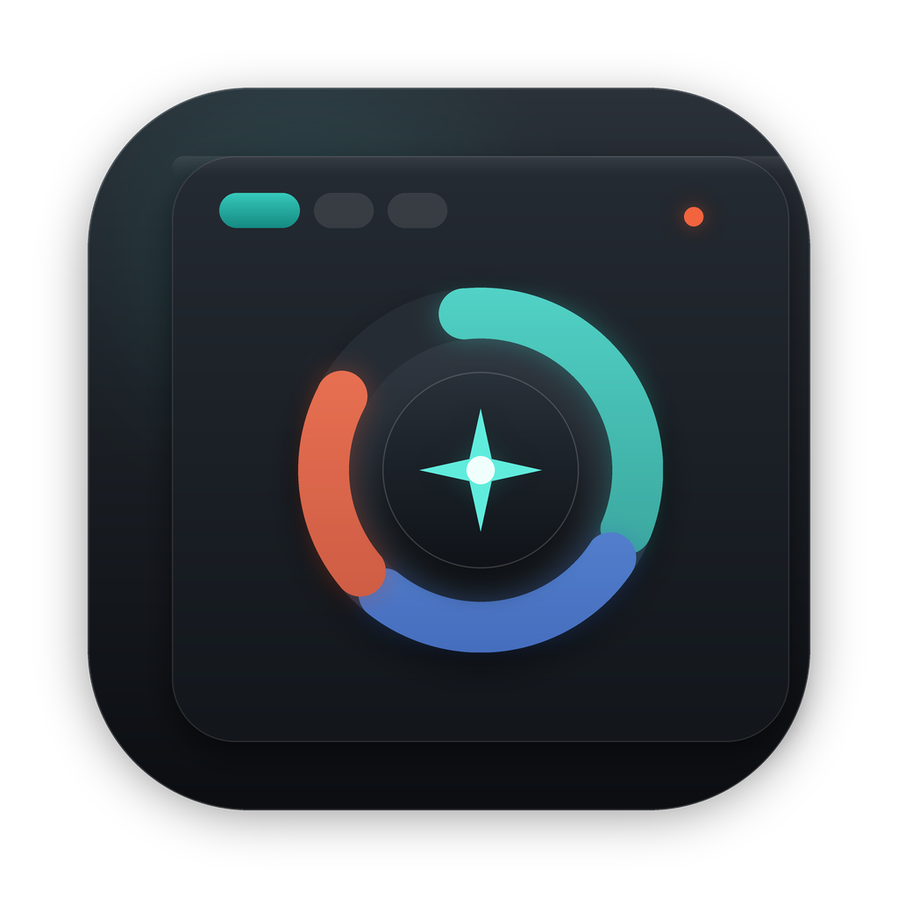

  

<h1 align="center">WorkGent</h1>

macOS 菜单栏 AI 工具状态看板：多个工具在跑什么、卡在哪、要不要你点一下，一屏看完。

  
  
  

> 本仓库仅用于产品展示与问题反馈，**不包含源代码**（闭源软件）。

---

## 是什么

同时开几个 AI 编程工具时，最烦的是「不知道哪个在等我」。WorkGent 常驻菜单栏，把豆包工作、WorkBuddy（国内版 / 国际版）、Trae CN 的状态收进一个面板：执行中、待授权、待回答、已完成、出错，各自一眼可辨；需要你点的地方，直接在面板里点，不用切窗口。

它不上传任何数据，只读本机的窗口状态与本地数据库。

## 支持的工具

| 工具 | 能读到什么 |
|---|---|
| 豆包工作 | 按项目 / 会话拆分的任务列表，运行数实时变化 |
| WorkBuddy 国内版 | 逐实例的会话状态，多开也能分别显示 |
| WorkBuddy 国际版 | 同上，登录态独立 |
| Trae CN | 侧栏统计文案 + 磁盘活动度 + 窗口标题三级降级 |

## 功能

**状态看板**
- 默认每个工具一行：状态光条、图标、名称、最新任务、徽章、相对时间
- 只有「待授权 / 待回答」才展开成大卡，其余保持安静
- 状态色固定语义：待授权琥珀、出错红、执行中绿、已完成蓝、空闲灰；每个工具有专属色落在名称与光条上

**菜单栏**
- 四格「工作窗」图标，亮几格就是几个工具在跑，状态一变立刻重绘
- 不占 Dock，关窗不退出，只驻留菜单栏

**授权与交互**
- 检测到审批时在对应行出按钮，点击直接落到那个工具的窗口
- 同一应用挂多张确认卡片时逐条翻页，不会只处理第一条
- 提问卡片可直接点选选项并提交
- 待确认气泡是暖色小卡，点「去应用处理」跳到对应工具；同一条确认在真正消失前不会反复弹

**键盘灯效**
- 状态联动 RGB 灯效：执行中绿、待授权琥珀、完成蓝、出错红；写入后读回校验
- 灯效档位可在面板里选，接管开关默认关闭

**桌宠**
- 常驻桌面右下角，随状态换姿势、会说话、可拖动
- 待授权时在头顶弹「允许 / 拒绝 / 跳转」气泡
- 多套形象可切换，带走路、发呆、伸展循环动画

## 桌宠形象

| 待机 | 工作中 | 待确认 |
|---|---|---|
|  |  |  |

> 面板界面截图稍后补充。

## 系统要求

- macOS 13.0 或更高版本
- 首次运行需授予「辅助功能」与「输入监控」两项权限（系统设置 → 隐私与安全性）

## 下载

暂未提供公开下载（未做 Apple 公证）。如需试用或反馈问题，请在本仓库开 Issue。

## 隐私

- 只读取本机进程窗口的辅助功能信息与本地数据库，不抓取对话内容上传
- 不联网、无统计上报，日志只写本机
- 账号与令牌不随安装包分发

## 许可

专有软件，**源码不公开**。本仓库中的文字与图片仅用于产品介绍，未经许可不得复制、修改或再分发。详见 [LICENSE](LICENSE)。
